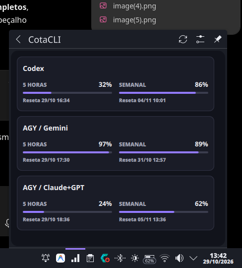
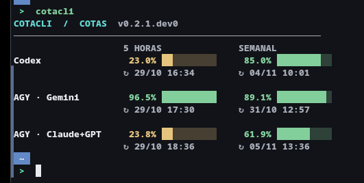

# CotaCLI

**Suas cotas de IA, em um lugar só.** Consulte o saldo restante no terminal ou no ícone da bandeja do KDE Plasma 6.


[](https://github.com/hallanbrito/CotaCLI/actions/workflows/check.yml)

O CotaCLI reúne as cotas de **Codex** e **Antigravity** sem abrir vários painéis. No Plasma, fica ao lado de Wi-Fi, bateria e relógio: o ícone mostra um resumo ao passar o mouse e abre os detalhes ao clicar. No Konsole, `cotacli` exibe a mesma informação em uma tabela compacta.

| Bandeja do KDE Plasma 6 | Terminal |
| --- | --- |
|  |  |

Capturas reais do protótipo no CachyOS, enviadas pelo autor. Os percentuais mudam conforme a conta e o horário.

| Fonte | Janela de 5 horas | Semanal | Como é lida |
| --- | --- | --- | --- |
| Codex CLI | Saldo e renovação | Saldo e renovação | `codex app-server` |
| AGY / Gemini | Saldo e renovação | Saldo e renovação | `agy -p /usage --output-format json` |
| AGY / Claude+GPT | Saldo e renovação | Saldo e renovação | Mesmo `/usage` do AGY |
| Claude Code (opcional) | Quando disponível | Quando disponível | JSON da status line, após uma resposta |

> **AGY / Claude+GPT** é a cota compartilhada de modelos dentro do Antigravity. Não representa uma assinatura do Claude Code. Se Claude Code estiver instalado, mas não fornecer cota válida, ele não aparece.

## E se eu não uso KDE Plasma?

O **monitor no terminal** funciona no Linux com Python 3.10+ sem instalar o widget. O instalador `install-widget.sh` e o painel da bandeja são específicos do **KDE Plasma 6**. Windows, macOS e outros desktops ainda não têm interface oficial nem instalação homologada.

Quer adaptar o projeto para o seu ambiente? Copie o [prompt de adaptação](docs/prompt.md), informe seu sistema operacional e ambiente gráfico, e peça ao seu agente de código para criar uma interface equivalente a partir deste repositório. O prompt exige testes reais no sistema de destino e documentação honesta; ele **não instala nem adapta o software sozinho**.

## Instalação rápida no CachyOS / Plasma 6

Requer **Python 3.10+**, `kpackagetool6` e o módulo `plasma5support` do KDE. Um provedor aparece quando sua CLI é detectada; se faltar autenticação ou a leitura falhar, o painel indica a indisponibilidade em vez de inventar valores.

```sh
git clone https://github.com/hallanbrito/CotaCLI.git
cd CotaCLI
bash install-widget.sh
```

O instalador é local, sem `sudo`. Ele copia `cotacli` para `~/.local/bin`, registra os caminhos das CLIs detectadas no terminal, instala o widget e recarrega o Plasma quando o serviço está ativo. O painel pode desaparecer por alguns segundos. Na bandeja: botão direito → **Configurar bandeja do sistema** → **Entradas** → **CotaCLI** → **Sempre visível**.

Se preferir somente o terminal, instale apenas o script:

```sh
install -Dm755 cotacli.py "$HOME/.local/bin/cotacli"
"$HOME/.local/bin/cotacli" discover
"$HOME/.local/bin/cotacli" refresh
```

## Uso

```sh
cotacli                   # leitura usando cache de até 10 minutos
cotacli refresh           # força nova consulta ao Codex e ao AGY
cotacli snapshot          # JSON consumido pelo widget
cotacli discover          # atualiza os caminhos das CLIs instaladas
```

Se `cotacli` não for encontrado no seu shell, use `~/.local/bin/cotacli`. Uma consulta do AGY pode levar até 60 segundos. O widget executa a consulta fora da interface gráfica para não travar o Plasma.

## Como funciona

- Mostra **percentual restante** e hora local de renovação. Nenhum número de cota é inventado.
- Usa somente as ferramentas detectadas. Sem leitura válida, o terminal informa o problema; o widget mostra `--` ou um erro.
- Aceita o resultado automático do AGY somente quando a resposta confirma **zero turnos e zero tokens**.
- Mantém cache local de 10 minutos; falhas podem exibir a última leitura, marcada como antiga.
- Não lê senhas, cookies ou tokens dos provedores. Cada CLI administra sua própria autenticação.

Para detalhes de instalação, comandos, formato JSON, limites conhecidos e integração opcional do Claude Code, veja a [documentação](docs/).

## Estado do projeto

Este repositório publica **código-fonte do protótipo**. Ainda não há pré-release nem release. O fluxo de Codex e AGY foi validado no CachyOS; a integração de cota do Claude Code tem testes com JSON sintético, mas ainda precisa de homologação em uma conta Pro/Max real. O popup do Plasma depende de teste visual no desktop de destino.

Contribuições são bem-vindas: leia [CONTRIBUTING.md](CONTRIBUTING.md). Licença [MIT](LICENSE).
