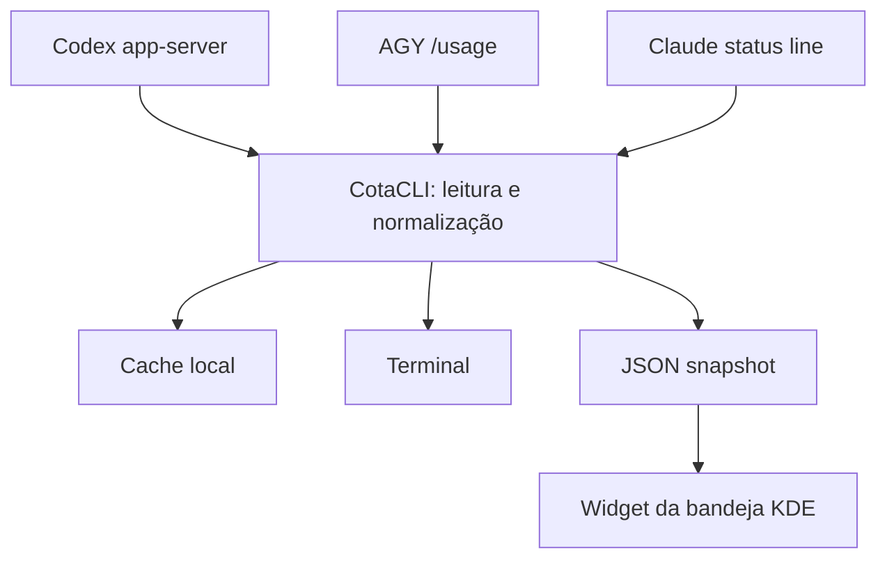

# Arquitetura

O motor é um único arquivo Python 3.10+ (`cotacli.py`) com biblioteca padrão. O applet do Plasma 6 é uma camada QML que consome o comando `snapshot`; ele não interpreta credenciais nem implementa protocolos de provedores.

## Fluxo de atualização

1. `cotacli` usa cache de até 10 minutos para Codex e AGY. `refresh` e `snapshot --refresh` forçam uma nova consulta.
2. Codex inicia `codex app-server`, faz a inicialização RPC e solicita somente `account/rateLimits/read`.
3. AGY executa apenas o comando interno `/usage` em modo JSON, sem prompt de inferência. Respostas que registrem turnos ou tokens são rejeitadas.
4. Claude Code não é consultado pelo widget; se configurado, o próprio Claude envia o JSON à status line, e CotaCLI retém somente as janelas de cota válidas.
5. `snapshot` normaliza os dados com `schema: 1`. O widget lê o JSON em um processo assíncrono do Plasma e desenha os cartões; o tooltip resume a janela de 5 horas.

## Dados locais

| Caminho | Conteúdo |
| --- | --- |
| `~/.cache/cotacli/codex.json` | Última leitura de janelas Codex e instante da consulta. |
| `~/.cache/cotacli/agy.json` | Grupos AGY e instante da consulta. |
| `~/.cache/cotacli/claude.json` | Janelas Claude capturadas e instante da captura. |
| `~/.config/cotacli/cli-paths.json` | Caminhos absolutos das CLIs detectadas pelo terminal. |
| `~/.config/cotacli/antigravity.json` | Valores manuais opcionais para contingência. |

Os arquivos são escritos com permissão somente do usuário e substituição atômica. O CotaCLI não lê os arquivos de autenticação dos provedores nem armazena prompts, respostas, cookies ou tokens. A sua CLI de origem ainda pode fazer uma consulta de rede própria ao verificar a cota; CotaCLI não adiciona telemetria.

## Limites de validação

Os testes automatizados verificam detecção de CLIs, contrato JSON, grupos AGY, rejeição de consumo de tokens e diferença de `PATH` entre terminal e Plasma. QML e comportamento visual do popup dependem de execução num KDE Plasma 6 real. Não há release publicada enquanto a integração e a instalação em outras máquinas não forem homologadas.
